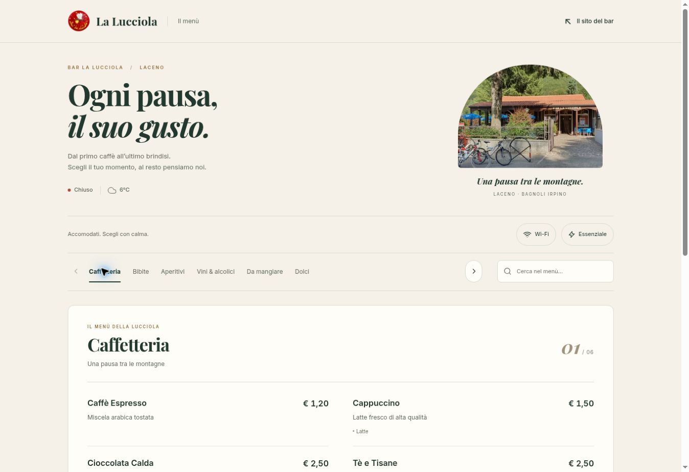

# Sito web Bar La Lucciola

Bozza indipendente del sito del bar al Laceno, con menù digitale verde bosco.

## Struttura
- `index.html`: presentazione, galleria e contatti.
- `menu/`: menù completo, avvisi, tema Natale, ricerca e recensioni.
- `menu/images/`: immagini del locale e loghi.
- `_headers`: intestazioni per hosting compatibili.

## Dati
Il menù legge il nuovo foglio Google pubblicato, scheda Dati sito. Gli orari mantengono il precedente CSV fino alla comunicazione del nuovo collegamento. Le sorgenti sono configurate in `assets/site-core.js`.

## Anteprima locale
Dalla cartella principale: `python -m http.server 8000`, poi aprire http://localhost:8000.

## Verifiche
`node --test menu/tests/menu.test.cjs`

Il caricamento su GitHub non attiva la pubblicazione ufficiale. Prima del lancio confermare testi, servizi e informativa privacy per l’hosting scelto.

Design by Giandomenico Nigro.

## Aggiornamento 4 novembre 2026
- Home e menù condividono colori, caratteri, pulsanti e navigazione di ritorno.
- Collegamenti alle categorie: `menu/?categoria=calde`, `fredde`, `aperitivi`, `alcolici`, `food`, `dolci`.
- Configurazione e logica orari condivise in `assets/site-core.js`. I dati incompleti o non validi non vengono presentati come orari verificati. In assenza di rete viene segnalata l'eventuale copia salvata.
- Immagini WebP responsive in `assets/`; originali conservati in `menu/images/`.
- La home usa solo script e caratteri locali. I dati del foglio vengono trattati come contenuto non attendibile.
- Test: `node --test assets/site-core.test.cjs menu/tests/menu.test.cjs`.
- Pubblicazione ufficiale ancora da completare. Gli orari usano il CSV già configurato fino alla consegna del nuovo collegamento.

## Proposta grafica del menù — da approvare
La proposta completa è disponibile in `menu-bozza/`, separata dal menù attuale. La home continua a collegarsi a `menu/` fino alla conferma. Per provarla: `/menu-bozza/`; Natale: `/menu-bozza/?tema=natale`; categoria: `/menu-bozza/?categoria=dolci`.

La proposta legge gli stessi dati reali e include ricerca, categorie con frecce e tastiera, prezzi e allergeni, stato apertura, meteo, Wi-Fi, recensioni e programmazione natalizia. Le finestre usano dialog nativi per focus, Escape e ritorno al comando iniziale. Nessun servizio di tracciamento aggiunto.

Verifiche: `node --test assets/site-core.test.cjs menu/tests/menu.test.cjs menu-bozza/tests/menu-preview.test.cjs`.

